# Publishing and Subscribing to Custom Events using Azure Event Grid

Comprehensive laboratory infrastructure deployment detailing the creation of a custom Event Grid topic, deploying a web application viewer endpoint via ARM template, subscribing the endpoint to the topic, and publishing custom JSON event payloads using Azure CLI.

---

## 1. Architecture & Provisioned Resources

### Core Infrastructure Topology

| Resource Type | Resource Name | Specification / Tier | Region / Location |
| :--- | :--- | :--- | :--- |
| **Event Grid Topic** | `az204-egtopic-153473750` | Basic SKU, EventGridSchema Input | East US |
| **App Service Plan** | `viewerhost` | Free Tier (F1 SKU) | East US |
| **App Service (Web App)** | `az204-egsite-153473750` | Azure Event Grid Viewer Endpoint | East US |
| **Event Subscription** | `az204ViewerSub` | WebHook Endpoint (`.../api/updates`) | East US |

---

### Provisioned Environment Validation

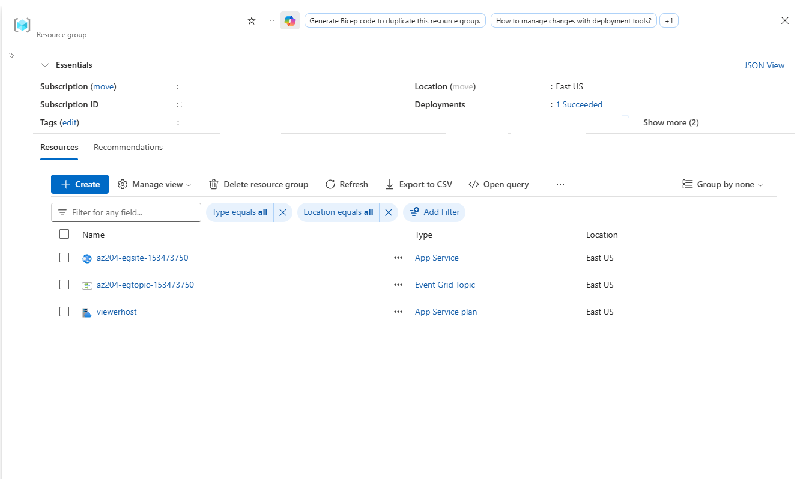

*Resource group overview confirming successful deployment of the custom Event Grid Topic, App Service Plan, and App Service web application viewer.*

---

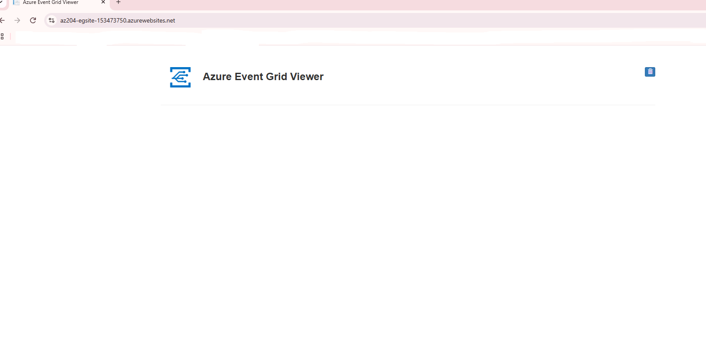

*Web application viewer interface accessible at the deployed App Service URL prior to receiving event subscriptions.*

---

## 2. Step-by-Step Implementation

### Step 1: Initialize Environment Variables and Register Provider

Declared environment variables for location, topic name, site name, and URL, and verified that the `Microsoft.EventGrid` resource provider is registered.

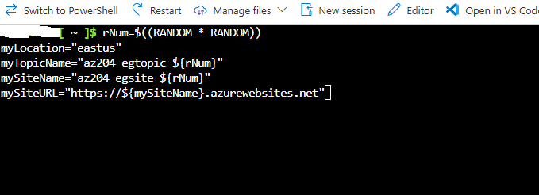

*Setting CLI environment variables for unique topic and web app site resources.*

---

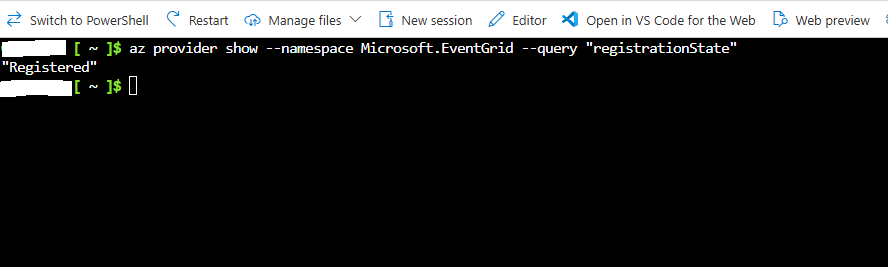

*Confirming Microsoft.EventGrid resource provider registration status.*

---

### Step 2: Create Custom Event Grid Topic

Created an Event Grid custom topic using Azure CLI to serve as the endpoint for publishing application events.

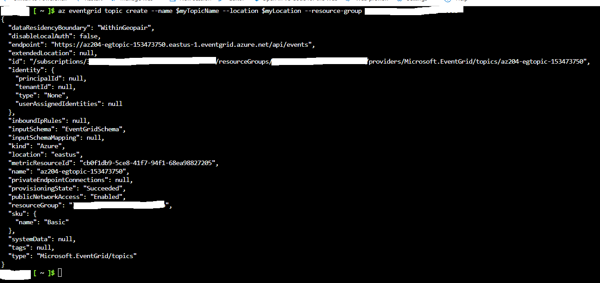

*Azure CLI output displaying successful provisioning of the custom Event Grid topic az204-egtopic-153473750.*

---

### Step 3: Deploy Event Grid Viewer Web Application

Deployed the Azure Event Grid Viewer web app endpoint using an ARM template deployment to visualize event delivery in real time.

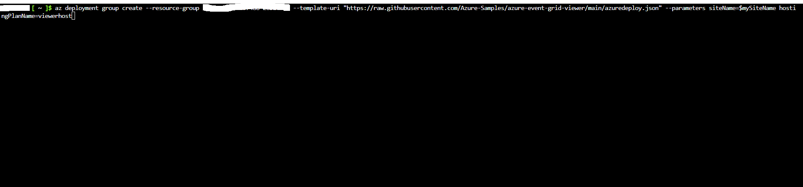

*Executing az deployment group create to deploy the Azure Event Grid Viewer site viewerhost.*

---

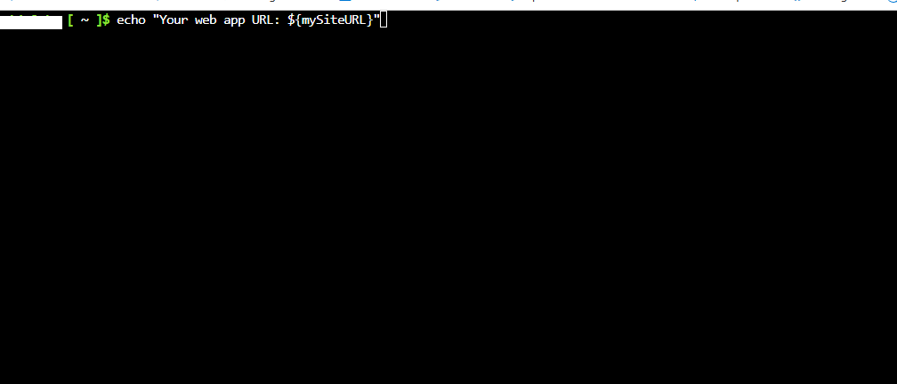

*Displaying the provisioned web application site URL.*

---

### Step 4: Create Event Grid Subscription

Subscribed the web application webhook endpoint (`az204ViewerSub`) to the custom Event Grid topic using Azure CLI.

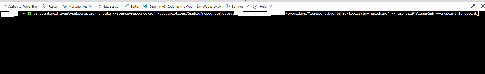

*Creating the event subscription targeting the web application endpoint.*

---

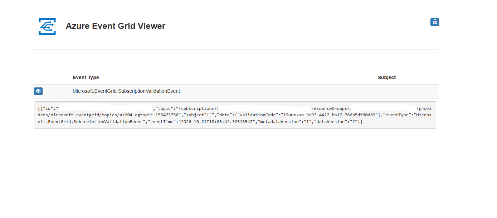

*Azure Event Grid Viewer displaying the received SubscriptionValidationEvent handshake log.*

---

### Step 5: Retrieve Topic Endpoint and Access Keys

Queried the Event Grid topic endpoint URL and SAS authentication key required for publishing events via HTTP POST.

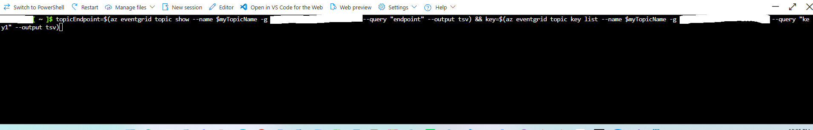

*Retrieving topic endpoint URL and primary SAS key using Azure CLI.*

---

### Step 6: Construct Custom Event JSON Payload

Formatted a custom JSON event array containing event metadata, event type, subject, and payload details.

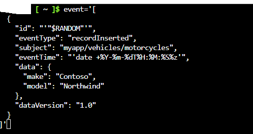

*Constructing the JSON payload for a recordInserted custom event type.*

---

### Step 7: Publish Custom Event Payload via HTTP POST

Executed a `curl` request passing the SAS authentication key header and JSON payload to the Event Grid topic endpoint.

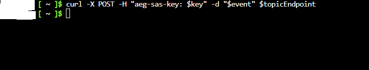

*Publishing the event payload to the Event Grid topic using cURL.*

---

### Step 8: Verify Real-Time Event Processing

Accessed the web viewer interface to confirm successful real-time ingestion and display of the published event.

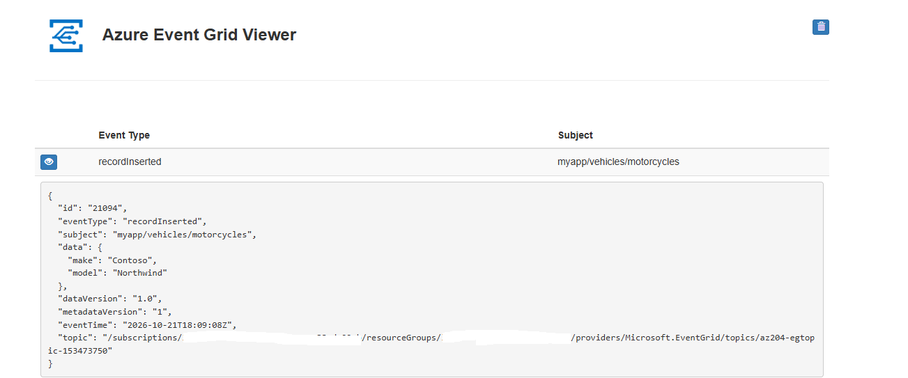

*Azure Event Grid Viewer confirming receipt and rendering of the published recordInserted custom event payload.*
